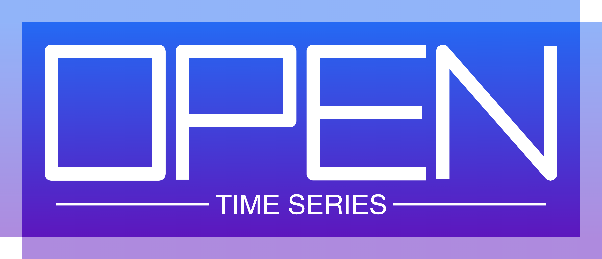
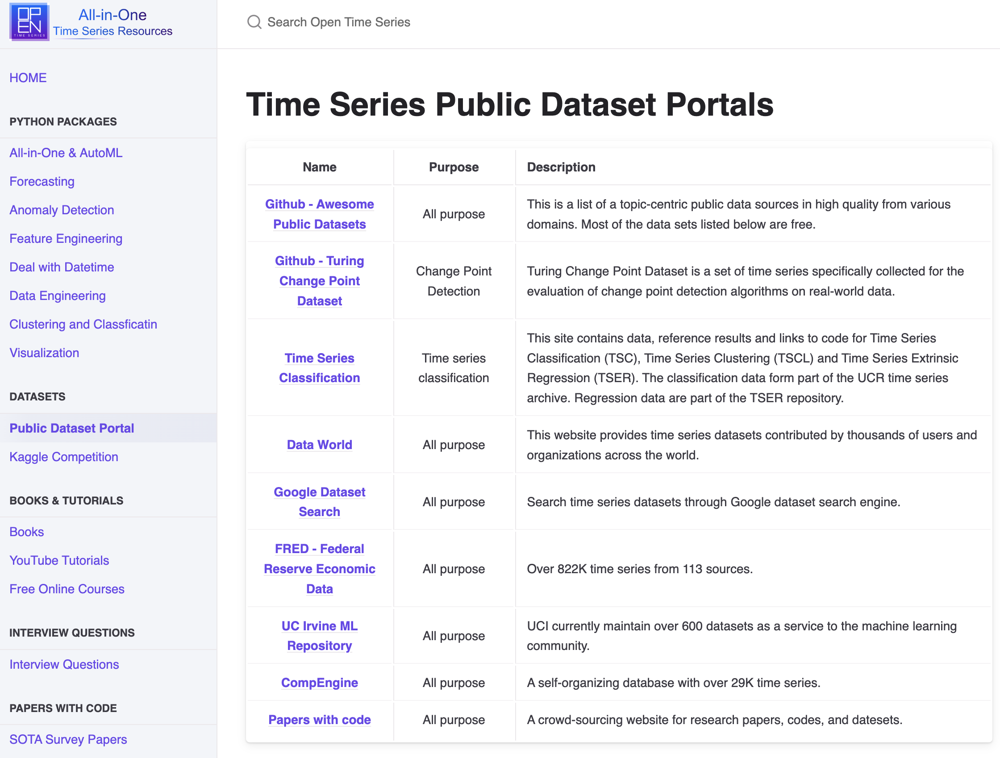

# Welcome to Open Time Series!
💬 We aim to provide a comprehensive one-stop destination for time series resources. Explore a wide range of resources, including Python packages, books, tutorials, interview questions, and more!

### 📦Python Packages

### 🗄️Datasets

### 📚Books & Tutorials

### ☎️Interview Questions

### 📄️Papers with Code

## [Let's get started!](https://opentimeseries.com)
* 📦[Python Packages](https://opentimeseries.com/python_packages/all_in_one/)
* 🗄️[Datasets](https://opentimeseries.com/datasets/public_datasets/)
* 📚[Books and Tutorials](https://opentimeseries.com/tutorials/books/)
* ☎️[Interview Questions](https://opentimeseries.com/interview_questions/interview_questions/)
* 📄[Papers with Code](https://opentimeseries.com/paper_with_code/survey/)
