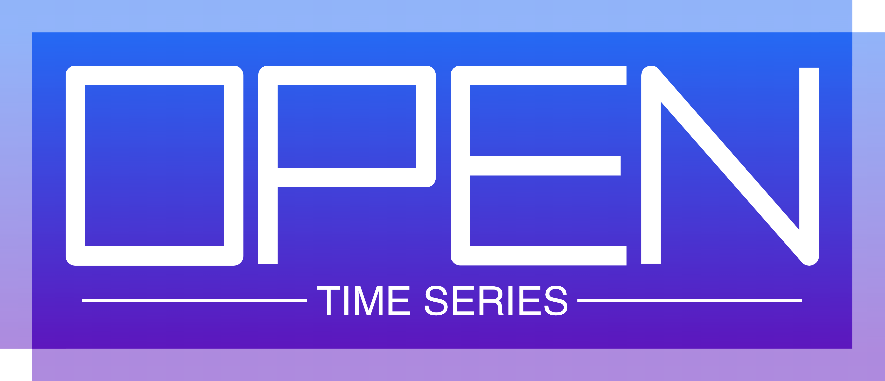

<section class="ots-hero">
  

    
Open Time Series

    <h1>Find the right time series resource faster.</h1>
    

      A curated map of Python packages, datasets, tutorials, survey papers, and interview prep for forecasting, anomaly detection, feature engineering, and time-series foundation models.
    

    

      <a href="/python_packages/all_in_one/" class="btn btn-primary fs-5">Explore Python Packages</a>
      <a href="/paper_with_code/survey/" class="btn fs-5">Read Survey Papers</a>
    

  

  

    
  

</section>

<section class="ots-section">
  

    
Start Here

    <h2>Choose the task you care about.</h2>
    
Use these as the fastest paths into the site instead of browsing everything at once.

  

  

    <a class="ots-card" href="/python_packages/forecasting/">
      <h3>I Want to Forecast</h3>
      
Start with forecasting libraries, benchmark datasets, and model families from classical methods to foundation models.

      Go to Forecasting
    </a>
    <a class="ots-card" href="/python_packages/anomaly_and_changepoint/">
      <h3>I Need Anomaly Detection</h3>
      
Browse toolkits for changepoints, monitoring, matrix profiles, outlier detection, and production-oriented anomaly workflows.

      Go to Anomaly Detection
    </a>
    <a class="ots-card" href="/python_packages/llm_for_time_series/">
      <h3>I Want Foundation Models</h3>
      
Compare Chronos, TimesFM, MOMENT, MOIRAI, TimeGPT, OpenLTM, and related GitHub collections.

      Go to Foundation Models
    </a>
    <a class="ots-card" href="/interview_questions/interview_questions/">
      <h3>I Am Preparing for Interviews</h3>
      
Review core modeling concepts plus newer questions on data leakage, zero-shot forecasting, intervals, and model selection.

      Go to Interview Questions
    </a>
  

</section>

<section class="ots-section">
  

    
Top Picks

    <h2>Start with the pages that save the most time.</h2>
  

  

    

      <h3>Best place to start</h3>
      
<a href="/python_packages/all_in_one/">All-in-One & AutoML</a> if you want a broad overview before choosing a narrower path.

    

    

      <h3>Best for modern forecasting</h3>
      
<a href="/python_packages/forecasting/">Forecasting</a> if you want strong practical libraries across classical, deep learning, and foundation-model tooling.

    

    

      <h3>Best for keeping up</h3>
      
<a href="/paper_with_code/survey/">SOTA Survey Papers</a> if you want recent summaries before diving into individual repos and papers.

    

  

</section>

<section class="ots-section">
  

    
Browse

    <h2>Jump directly to the kind of resource you need.</h2>
  

  

    <a class="ots-list-card" href="/datasets/public_datasets/">
      <h3>Datasets</h3>
      
Public dataset portals, benchmark repositories, Kaggle collections, and foundation-model evaluation resources.

    </a>
    <a class="ots-list-card" href="/datasets/kaggle/">
      <h3>Kaggle Competitions</h3>
      
Well-known forecasting competitions and a live search entry for more recent competition-style datasets.

    </a>
    <a class="ots-list-card" href="/tutorials/books/">
      <h3>Books</h3>
      
Books that cover practical forecasting, anomaly detection, and real-world ML workflows for time series.

    </a>
    <a class="ots-list-card" href="/tutorials/online_courses/">
      <h3>Courses</h3>
      
Free or accessible courses for Python forecasting, validation, deep learning, and hands-on modeling.

    </a>
    <a class="ots-list-card" href="/tutorials/youtube_tutorials/">
      <h3>YouTube Tutorials</h3>
      
Playlists and long-form videos for learning concepts quickly or following code-first walkthroughs.

    </a>
    <a class="ots-list-card" href="/python_packages/feature_engineering/">
      <h3>Feature Engineering</h3>
      
Feature extraction, entropy and complexity measures, smoothing, and automated feature generation libraries.

    </a>
    <a class="ots-list-card" href="/journal_and_conference/journal_and_conference/">
      <h3>Journal and Conference</h3>
      
Common journals and conferences for time-series, forecasting, anomaly detection, and machine learning research.

    </a>
  

</section>

<section class="ots-section">
  

    
Paths

    <h2>Follow a path based on how you plan to use the site.</h2>
  

  

    

      <h3>Beginner path</h3>
      
Books -> Online Courses -> Forecasting -> Public Datasets

    

    

      <h3>Production path</h3>
      
All-in-One -> Forecasting -> Anomaly Detection -> Data Engineering

    

    

      <h3>Research path</h3>
      
Survey Papers -> Foundation Models -> Public Datasets -> Kaggle Competitions

    

  

</section>
